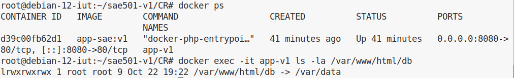
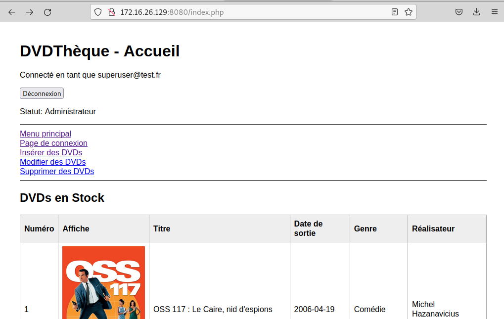
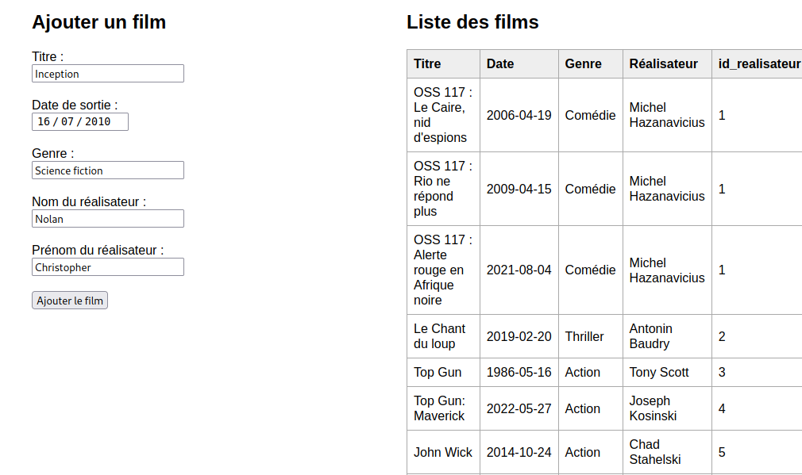
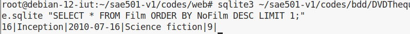
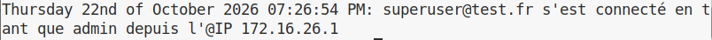

# Compte-Rendu — SAé 5.01 : Version 1 (Conteneurisation PHP & SQLite)

**Auteur :** Mbango Samantha  
**Formation :** BUT3 Réseaux et Télécommunications — IUT de Lannion  
**Année :** 2026-2027  
**Visa :** VISA 1  

---

## 1. Description et Objectifs

Cette première phase consiste à encapsuler l'application issue de la SAé 23 (DVDThèque) dans un conteneur Docker autonome (Apache/PHP 8.2).  
Les contraintes d'architecture sont :
- Séparation de la base métier (`DVDTheque.sqlite`) et de la base d'authentification (`comptes.sqlite`).
- Persistance complète des données via montage de volume (*bind mount*).
- Gestion des permissions système pour le moteur SQLite et le serveur Apache (`www-data`).
- Traçabilité des accès dans un fichier journal (`logins.log`).

---

## 2. Arborescence du Dépôt

```text
sae501-v1/
├── codes/
│   ├── bdd/
│   │   ├── DVDTheque.sqlite
│   │   └── comptes.sqlite
│   └── web/
│       ├── Dockerfile
│       └── code/
│           ├── index.php
│           ├── connexion.php
│           ├── fonctions.php
│           ├── formulaires.php
│           ├── insertion.php
│           ├── modification.php
│           ├── suppression.php
│           ├── captcha.php
│           ├── css/styles.css
│           ├── js/
│           ├── php_ajax/
│           ├── logs/logins.log
│           └── images/
└── CR/
    ├── rapport_1_MBANGO.md
    ├── rapport_1_MBANGO.pdf
    └── images/
        ├── capture1.png
        ├── capture2.png
        ├── capture3.png
        ├── capture4.png
        └── capture5.png
```

---

## 3. Conception du `Dockerfile`

Le fichier `codes/web/Dockerfile` compile les extensions nécessaires sur une base `php:8.2-apache` :

```dockerfile
FROM php:8.2-apache

# Dépendances système pour SQLite et la bibliothèque GD (captcha)
RUN apt-get update && apt-get install -y \
    libsqlite3-dev \
    libpng-dev \
    libjpeg-dev \
    libfreetype6-dev \
    && docker-php-ext-configure gd --with-freetype --with-jpeg \
    && docker-php-ext-install -j$(nproc) pdo_sqlite gd

RUN a2enmod rewrite
```

* **`pdo_sqlite` :** interface d'abstraction PDO pour manipuler les bases SQLite.
* **`gd` :** génération dynamique de l'image de sécurité antirobot (`captcha.php`).

---

## 4. Notice d'Installation et de Déploiement

### 4.1. Préparation des droits hôte
```bash
cd ~/sae501-v1
chown -R www-data:www-data codes/bdd codes/web/code
chmod -R 775 codes/bdd
chmod -R 775 codes/web/code/logs codes/web/code/images
```

### 4.2. Construction de l'image Docker
```bash
cd ~/sae501-v1/codes/web
docker build -t app-sae:v1 .
```

### 4.3. Instanciation du conteneur
```bash
docker run -d -p 8080:80 -v ~/sae501-v1/codes/web/code:/var/www/html -v ~/sae501-v1/codes/bdd:/var/data --name app-v1 app-sae:v1
```

### 4.4. Configuration du lien symbolique
Le code PHP exploitant le chemin relatif `db/`, un lien symbolique redirige les requêtes vers le volume persistant `/var/data` :
```bash
docker exec -it app-v1 ln -s /var/data /var/www/html/db
```

---

## 5. Tests et Preuves de Bon Fonctionnement

### 5.1. Déploiement et conteneur actif
Contrôle du conteneur en cours d'exécution et validation du lien symbolique interne :



### 5.2. Authentification et Session Administrateur
Connexion sur `http://172.16.26.129:8080/connexion.php` avec le compte `superuser@test.fr` / `L@nnion`. Redirection vers l'accueil affichant les droits administrateur :



### 5.3. Test d'écriture et Persistance
Ajout d'un nouveau film depuis l'interface web (`insertion.php`) :



Vérification directe sur l'hôte physique de l'insertion dans la base SQLite :
```bash
sqlite3 ~/sae501-v1/codes/bdd/DVDTheque.sqlite "SELECT * FROM Film ORDER BY NoFilm DESC LIMIT 1;"
```



### 5.4. Traçabilité des Accès
Contrôle de l'écriture de l'adresse IP et de l'horodatage dans le fichier journal :
```bash
cat ~/sae501-v1/codes/web/code/logs/logins.log
```


