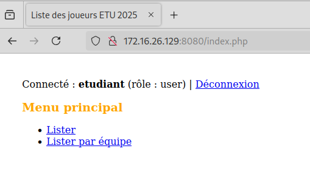
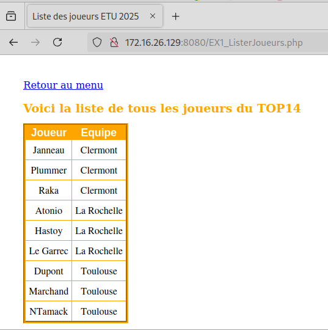
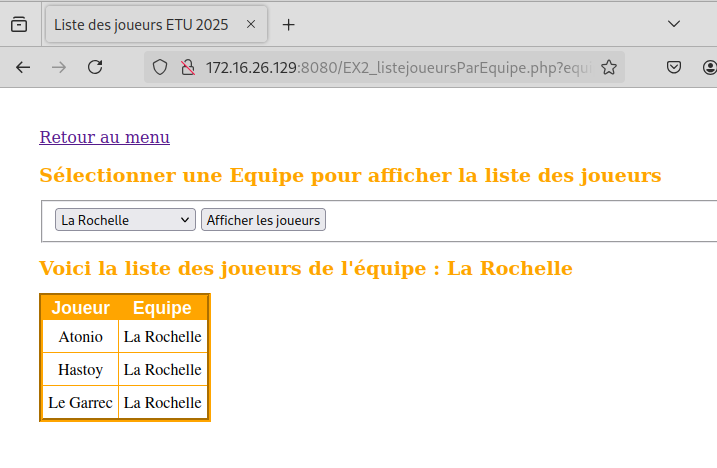
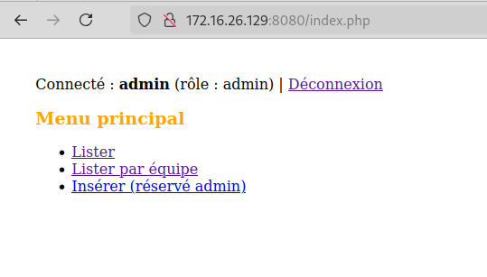
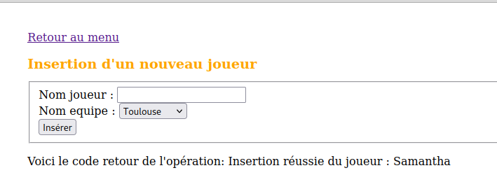
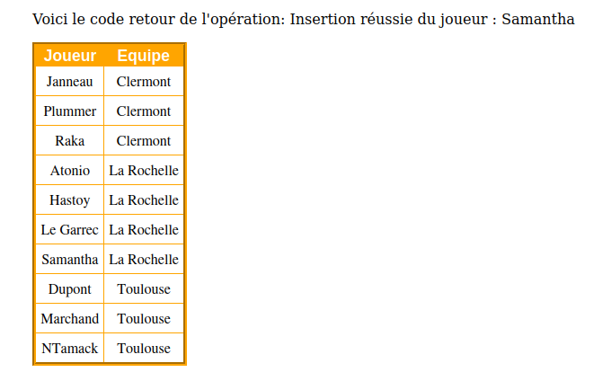

# Compte-Rendu SAé 5.01 — Version 1 (VISA 1)

**Auteur :** Samantha MBANGO  
**Dépôt distant :** [github.com/smbango/sae501](https://github.com/smbango/sae501)  
**Machine de test :** VM Debian 12 (IUT-Docker) — `172.16.26.129`  

---

## 1. Contexte et Objectifs

Dans le cadre de la **SAé 5.01**, l'objectif de la **Version 1** est de migrer et conteneuriser l'application Web PHP issue de la SAÉ23 (gestion d'un tournoi de rugby) sous Docker.

Les attendus pour ce premier VISA sont :
1. **Conteneurisation autonome** : rédaction d'un `Dockerfile` adapté (Apache, PHP 8.2, support de l'extension `pdo_sqlite`).
2. **Double base de données SQLite** :
   - `data.db` : tables métier `equipes` et `joueurs`.
   - `auth.db` : table de sécurité `users` avec gestion des rôles (`admin` et `user`).
3. **Persistance des données** : utilisation d'un bind mount reliant le dossier hôte `/root/sae501-v1/codes/bdd` au point de montage `/var/data` dans le conteneur.
4. **Contrôle d'accès par sessions** :
   - `user` : consultation générale et filtrage par équipe.
   - `admin` : consultation et formulaire d'insertion de nouveaux joueurs.
5. **Gestion de version et livrables** : arborescence normalisée, historique Git et publication sur GitHub.

---

## 2. Arborescence du Projet

L'arborescence mise en place respecte strictement le découpage demandé au point 5.3 du sujet :

```text
sae501-v1/
├── codes/
│   ├── bdd/
│   │   ├── auth.db               # Base SQLite des comptes/rôles
│   │   └── data.db               # Base SQLite rugby (joueurs, equipes)
│   └── web/
│       ├── Dockerfile            # Recette de construction de l'image
│       └── code/                 # Code source de l'application
│           ├── index.php         # Authentification et menu principal
│           ├── fonctions.php     # Connexions PDO et requêtes SQL
│           ├── EX1_ListerJoueurs.php
│           ├── EX2_listejoueursParEquipe.php
│           ├── EX3_InsererJoueurs.php
│           └── style.css       
└── CR/
    ├── rapport_visa_1_sae501_MBANGO.md       # Présent compte-rendu
    └── images/                   # Captures d'écran
```

---

## 3. Mise en Œuvre Technique

### 3.1. Bases de données SQLite

- **Base `auth.db`** :
  ```sql
  CREATE TABLE users (
      id INTEGER PRIMARY KEY AUTOINCREMENT,
      username TEXT UNIQUE NOT NULL,
      password TEXT NOT NULL,
      role TEXT NOT NULL CHECK(role IN ('admin', 'user'))
  );
  INSERT INTO users (username, password, role) VALUES 
  ('admin', 'admin', 'admin'),
  ('etudiant', 'etudiant', 'user');
  ```

- **Base `data.db`** :
  Contient les données issues de la SAÉ23 (tables `equipes` et `joueurs` avec les clés étrangères associées).

### 3.2. Spécification Docker (`Dockerfile`)

Le conteneur utilise l'image officielle PHP 8.2 avec Apache. L'extension `pdo_sqlite` est compilée et activée à la construction :

```dockerfile
FROM php:8.2-apache

RUN apt-get update && apt-get install -y sqlite3 libsqlite3-dev \
    && docker-php-ext-install pdo pdo_sqlite \
    && rm -rf /var/lib/apt/lists/*

COPY code/ /var/www/html/

RUN mkdir -p /var/data && chmod 777 /var/data

EXPOSE 80
```

### 3.3. Commandes de Construction et de Déploiement

- **Build de l'image :**
  ```bash
  cd ~/sae501-v1/codes/web
  docker build -t sae501-web:v1 .
  ```

- **Exécution du conteneur avec volume persistant et mappage de port :**
  ```bash
  docker run -d -p 8080:80 -v /root/sae501-v1/codes/bdd:/var/data --name app-v1 sae501-web:v1
  ```

---

## 4. Preuves de Fonctionnement et Validation

L'application a été validée via le navigateur sur l'adresse `http://172.16.26.129:8080`.

### 4.1. Consultation et style (Rôle simple `user`)
- Connexion avec le compte `etudiant` / `etudiant`.
- Affichage de l'ensemble des joueurs via `EX1_ListerJoueurs.php`.
- Le lien vers n'est pas disponible car compte **etudiant**.



*Figure 1 & 2 — Liste globale des joueurs.*

### 4.2. Filtrage par équipe
- Sélection d'une équipe spécifique via le formulaire de `EX2_listejoueursParEquipe.php`.
- Filtrage correct des enregistrements sans rechargement erroné.


*Figure 3 — Affichage filtré des joueurs d'une équipe sélectionnée.*

### 4.3. Droits administrateur et insertion (Rôle `admin`)
- Connexion avec le compte `admin` / `admin`.
- Accès à la page `EX3_InsererJoueurs.php`.
- Ajout réussi d'un joueur et persistance immédiate dans `data.db`.




*Figure 4,5 & 6 — Insertion d'un nouveau joueur et affichage du tableau mis à jour.*

---

## 5. Bilan du Validation 1

- Déploiement conteneurisé fonctionnel et isolé.
- Séparation physique des deux bases de données (`data.db` et `auth.db`).
- Code source et documentation disponible sur Github. 