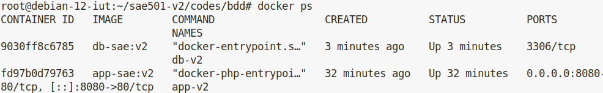
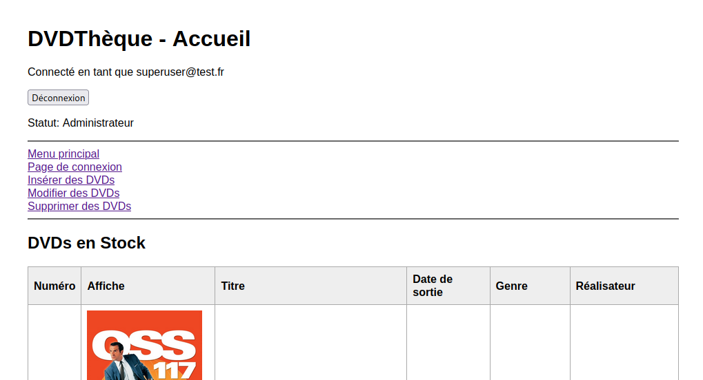
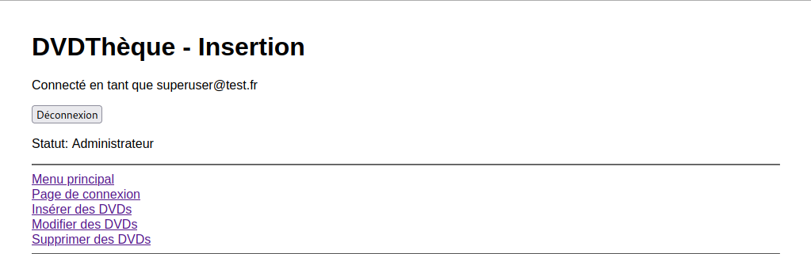
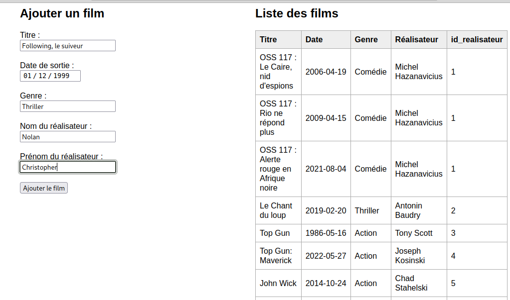
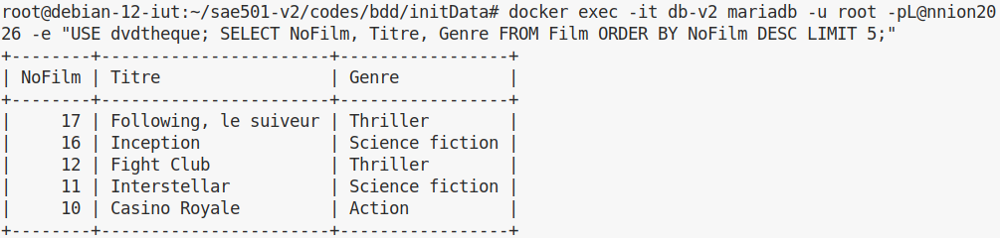
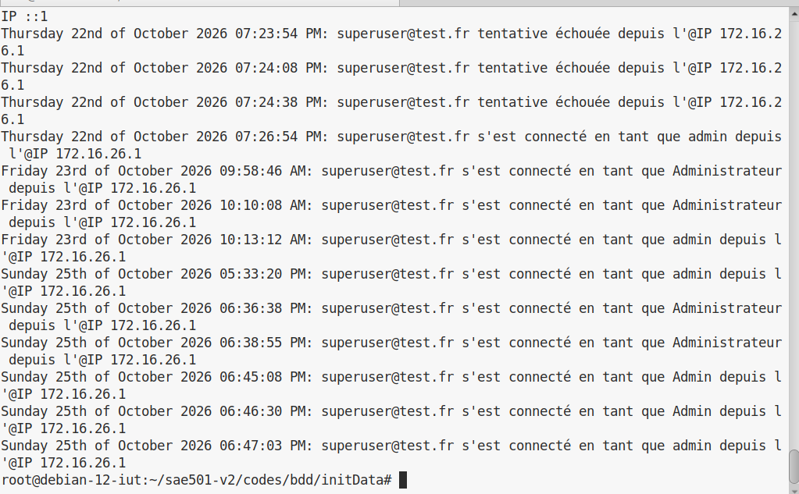

# Compte-Rendu — SAé 5.01 : Version 2 (Conteneurisation PHP & MariaDB)

**Auteur :** Mbango Samantha  
**Formation :** BUT3 Réseaux et Télécommunications — IUT de Lannion  
**Année :** 2026-2027  
**Visa :** VISA 2  

---

## 1. Description et Objectifs

Cette deuxième phase consiste à faire évoluer l'application **DVDThèque** vers une **architecture un peu plus complexe** (PHP 8.2 / Apache / MariaDB).  
Les contraintes d'architecture sont :
- Séparation physique et logique des services dans des conteneurs Docker distincts : un conteneur applicatif web (`app-v2`) et un conteneur de base de données relationnelle dédié (`db-v2`).
- Isolation et communication inter-conteneurs via un réseau virtuel Docker personnalisé de type bridge (`sae501-net`).
- Persistance complète des données de la base MariaDB via le montage d'un volume hôte (*bind mount*).
- Adaptation des scripts SQL d'initialisation (gestion de l'ordre des tables et contraintes de clés étrangères).
- Gestion des permissions système pour le serveur Apache (`www-data`).

---

## 2. Arborescence du Dépôt

```text
sae501-v2/
├── codes/
│   ├── bdd/
│   │   └── initData/
│   │       ├── 01_comptes.sql
│   │       └── 02_dvdtheque.sql
│   └── web/
│       ├── Dockerfile
│       └── code/
│           ├── index.php
│           ├── connexion.php
│           ├── fonctions.php
│           ├── formulaires.php
│           ├── insertion.php
│           ├── modification.php
│           ├── suppression.php
│           ├── captcha.php
│           ├── css/styles.css
│           ├── js/
│           ├── php_ajax/
│           ├── logs/logins.log
│           └── images/
└── CR/
    ├── rapport_2_MBANGO.md
    ├── rapport_2_MBANGO.pdf
    └── images/
        ├── capture1.2.png
        ├── capture2.2.png
        ├── capture3.2.1.png
        ├── capture3.2.2.png
        ├── capture4.2.png
        └── capture5.2.png
```

---

## 3. Conception du `Dockerfile` et Réseau

Le fichier `codes/web/Dockerfile` compile les extensions nécessaires sur une base `php:8.2-apache` :

```dockerfile
FROM php:8.2-apache

# Dépendances système pour MariaDB (PDO MySQL) et la bibliothèque GD (captcha)
RUN apt-get update && apt-get install -y \
    libpng-dev \
    libjpeg-dev \
    libfreetype6-dev \
    && docker-php-ext-configure gd --with-freetype --with-jpeg \
    && docker-php-ext-install -j$(nproc) pdo_mysql gd

RUN a2enmod rewrite
```

- **`pdo_mysql` :** interface d'abstraction PDO pour manipuler la base MariaDB.
- **`gd` :** génération dynamique de l'image de sécurité antirobot (`captcha.php`).

---

## 4. Notice d'Installation et de Déploiement

### 4.1. Création du réseau virtuel Docker
```bash
docker network create sae501-net
```

### 4.2. Préparation des droits hôte
```bash
cd ~/sae501-v2
chown -R www-data:www-data codes/bdd codes/web/code
chmod -R 775 codes/bdd
chmod -R 775 codes/web/code/logs codes/web/code/images
```

### 4.3. Instanciation du conteneur MariaDB (`db-v2`)
```bash
docker run -d --name db-v2 --network sae501-net -e MYSQL_ROOT_PASSWORD=L@nnion2026 -v ~/sae501-v2/codes/bdd/data:/var/lib/mysql mariadb:latest
```

### 4.4. Construction de l'image Docker Web
```bash
cd ~/sae501-v2/codes/web
docker build -t app-sae:v2 .
```

### 4.5. Instanciation du conteneur Applicatif (`app-v2`)
```bash
docker run -d --name app-v2 --network sae501-net -p 8080:80 -v ~/sae501-v2/codes/web/code:/var/www/html app-sae:v2
```
* ---

## 5. Tests et Preuves de Bon Fonctionnement

### 5.1. Déploiement et conteneurs actifs
Contrôle des conteneurs en cours d'exécution sur le réseau `sae501-net` :



### 5.2. Authentification et Session Administrateur
Connexion sur `http://172.16.26.129:8080/connexion.php` avec le compte `superuser@test.fr` / `L@nnion`. Redirection vers l'accueil affichant les droits administrateur :


### 5.3. Test d'écriture et Persistance MariaDB
Ajout d'un nouveau film depuis l'interface web (`insertion.php`) :





Vérification directe sur l'hôte physique de l'insertion dans la base MariaDB :
```bash
docker exec -it db-v2 mariadb -u root -pL@nnion2026 -e "USE dvdtheque; SELECT NoFilm, Titre, Genre FROM Film ORDER BY NoFilm DESC LIMIT 5;"
```



### 5.4. Traçabilité des Accès
Contrôle de l'écriture de l'adresse IP et de l'horodatage dans le fichier journal :
```bash
cat ~/sae501-v2/codes/web/code/logs/logins.log
```

